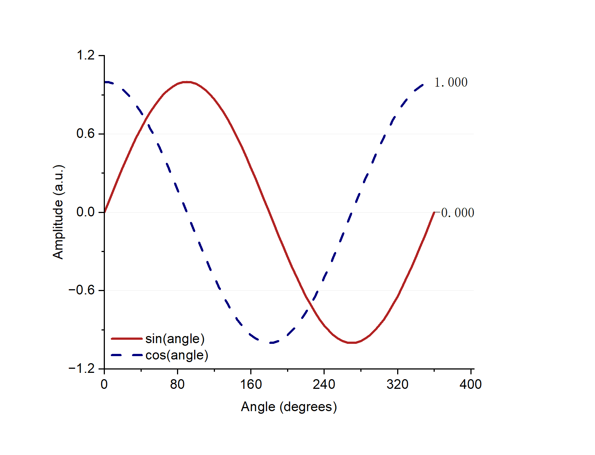

# WorkBuddy Bridge

[English](README.md) | [简体中文](README.zh-CN.md)

**Let your AI assistant use WorkBuddy.**

Ask your assistant to give WorkBuddy a task and bring back the result. It can use the models, MCP tools, and skills you already have in WorkBuddy—all from the chat you're using now.

## What can you do?

- Ask WorkBuddy to handle a task while you stay in your usual AI app.
- Use tools configured in WorkBuddy, such as Origin for plotting.
- Choose a model, check progress, get the result, or stop a task.

## Get started

Copy this and send it to your AI assistant to install:

> Install WorkBuddy Bridge for me: https://github.com/P-PPPP/workbuddy-bridge

[Manual installation](docs/REFERENCE.md#installation)

## Example: make a chart in Origin

If Origin MCP is already set up and working in WorkBuddy, ask:

> Use WorkBuddy and its Origin MCP to draw sine and cosine curves. Ask me which model and output folder to use, then save the chart as PNG and PDF.

This workflow was tested with OriginPro 2024. WorkBuddy created the chart below and exported both files:

You can also ask:

> Which MCP tools and skills can WorkBuddy use?

> Check the progress of my WorkBuddy task.

> Stop the current WorkBuddy task.

## A few things to know

- **Choose your model.** If you don't, WorkBuddy uses its own default, which may be Auto. Tasks use your WorkBuddy account and normal usage allowance.
- **These are separate task sessions.** They don't take over an existing desktop chat, and you shouldn't expect them to appear in WorkBuddy's chat history.
- **WorkBuddy's tools still need to be installed.** This project connects to your setup; it doesn't install Origin or other applications for you.
- **Keep local data private.** Task messages and results are saved on your computer. Don't upload your `data` folder or account files.

## Need help?

**Your AI app can't connect?** Check that Node.js 24+ is installed and that you copied the generated settings. From the project folder, run `npm run smoke` to check the connection without calling a model.

**WorkBuddy needs you to sign in?** Sign in again in the desktop app, then ask your assistant to start a new task session.

For tool details, custom settings, and troubleshooting, see the [technical reference](docs/REFERENCE.md). You can also [report an issue](https://github.com/P-PPPP/workbuddy-bridge/issues).

Tested with WorkBuddy 5.9.3 on Windows. This is an unofficial project; compatibility may change after WorkBuddy updates.

## License

[MIT](LICENSE). Personal and non-commercial use is encouraged; commercial use remains permitted.
