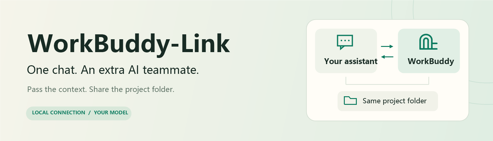
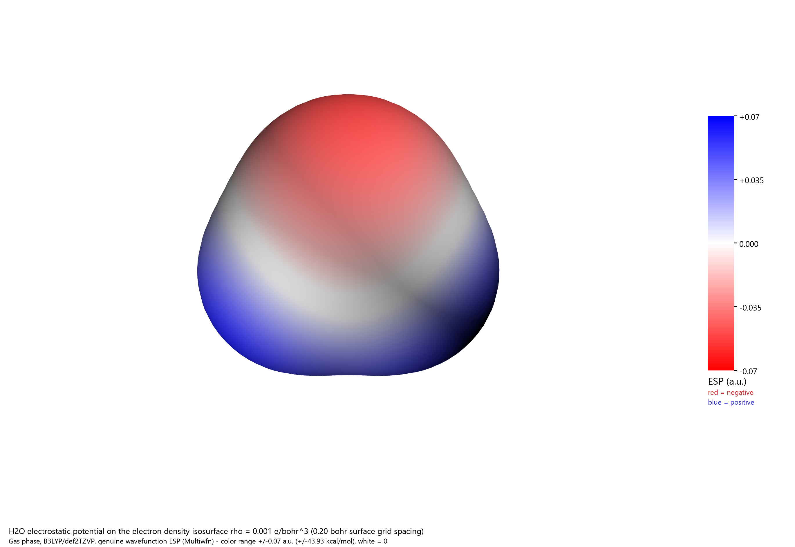

<div align="center">



# WorkBuddy-Link

**Let WorkBuddy do the work. Stay in your AI assistant.**

[](https://github.com/P-PPPP/WorkBuddy-Link/actions/workflows/test.yml)
[](#-before-you-start)
[](https://nodejs.org/)
[](LICENSE)

[English](README.md) · [简体中文](README.zh-CN.md)

</div>

Ask your AI assistant to delegate a task to WorkBuddy, pass along the relevant conversation context, and work in the same project folder. Get charts, models, and other results back in your current chat.

**The connector is free and needs no separate API key.** Tasks use your WorkBuddy account; its limits and any model charges still apply.

## ✨ What you get

| | What it means for you |
|:---:|---|
| 💬 **One conversation** | Delegate work and receive results without switching to another chat. |
| 📂 **Shared project files** | Pass the task brief, agreed requirements, and project folder path together. |
| 🛠️ **Your existing tools** | Use the MCP tools and skills you have configured in WorkBuddy. |
| 🎛️ **Your choice of model** | Choose the execution model, check progress, or stop a task. |

## 🚀 Get started

Copy this and send it to your AI assistant:

```text
Install WorkBuddy-Link for me: https://github.com/P-PPPP/WorkBuddy-Link
```

### 📋 Before you start

- A Windows computer with WorkBuddy installed and signed in.
- [Node.js 24+](https://nodejs.org/) and Git.
- An AI assistant that supports local MCP servers and can run the installation steps on your computer.
- For drawing or modeling: the corresponding tool must already work in WorkBuddy.

<details>
<summary>Prefer to install it manually?</summary>

Open PowerShell in the folder where you want to keep the project:

```powershell
git clone https://github.com/P-PPPP/WorkBuddy-Link.git
Set-Location WorkBuddy-Link
npm ci --ignore-scripts --no-audit --no-fund
npm run smoke
npm run configure
```

Copy the generated `workbuddy-link` entry into your AI assistant's MCP settings, keeping any existing servers. Reconnect the assistant, then ask it to check WorkBuddy's status. The smoke check does not call a model.

[Detailed setup and settings](docs/REFERENCE.md#installation)

</details>

## 💬 Just ask your assistant

Start with your current project:

> Give this task to WorkBuddy. Share the relevant context and our project folder path. Ask me which model to use first, then save the results in that folder and report back here.

Your assistant passes the context it selects; the full chat history is not synced automatically.

### 📈 Draw a chart in Origin

> Have WorkBuddy use Origin MCP to plot this data. Include the file paths, labels, and style we agreed on. Ask me which model to use, then save PNG and PDF files in our project folder.

The chart below was created through WorkBuddy using OriginPro 2024 and synthetic sine/cosine data. [Test notes](docs/VALIDATION.md#origin-mcp-demonstration)


### 🧊 Make a model in Blender

> Have WorkBuddy use Blender MCP to make a desk organizer using the dimensions and design we discussed. Ask me which model to use, then return the .blend file and a preview image in our project folder.

This is a suggested workflow; Blender has not been tested in this project.

### ⚛️ Calculate a molecule and draw its ESP

> Have WorkBuddy use its WSL Gaussian and Multiwfn skills to calculate water, check the optimized structure and frequencies, and save an ESP image and the calculation files in our project folder. Use GLM-5.3-Flash and record the actual token usage.

This example was run through WorkBuddy-Link. The calculation, image, bilingual instructions, and files for reproducing it are available in the [water DFT → ESP example](examples/water-dft-esp/).



### ⏯️ Check in or change direction

- “Which tools and skills can WorkBuddy use?”
- “Check the progress of my WorkBuddy task.”
- “Stop the current WorkBuddy task.”

## ❓ Quick answers

| Question | Answer |
|---|---|
| **Does it control my open WorkBuddy chat?** | It starts a separate task session. Do not expect it to appear in the desktop chat history. |
| **Which model does it use?** | Ask your assistant to let you choose first. Otherwise WorkBuddy uses its default, which may be Auto. |
| **A newer model is missing?** | Update WorkBuddy-Link and ask for the model list again. Listed candidates still need access through your account. |
| **My assistant cannot connect.** | Check Node.js 24+, reconnect the MCP server, and run `npm run smoke` in this project. |
| **WorkBuddy asks me to sign in.** | Sign in through the desktop app, then start a new task session. |

[More settings and troubleshooting](docs/REFERENCE.md) · [Report an issue](https://github.com/P-PPPP/WorkBuddy-Link/issues)

## 🔐 Privacy & compatibility

WorkBuddy-Link uses your local WorkBuddy sign-in. Task records stay on your computer; WorkBuddy sends the task and any tool-provided content to the services it uses. Only delegate files and tasks you intend it to access. Do not upload local account files or the `data` folder.

This is an unofficial community project, tested with **WorkBuddy 5.9.3 on Windows**. WorkBuddy updates may require compatibility fixes.

## 📄 License

[MIT](LICENSE). Personal learning and non-commercial use are encouraged as a voluntary preference; commercial use is permitted by the license.
