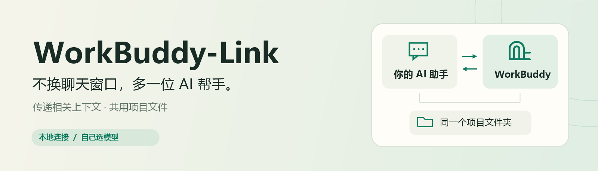
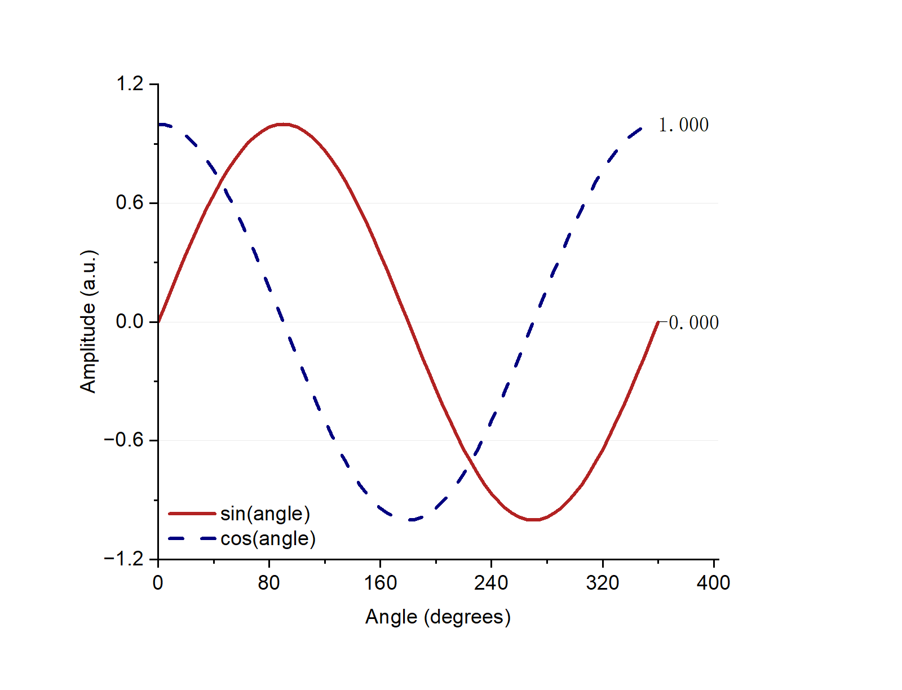

<div align="center">



# WorkBuddy-Link

**让 WorkBuddy 干活，你继续留在自己的 AI 助手里。**

[](https://github.com/P-PPPP/WorkBuddy-Link/actions/workflows/test.yml)
[](#-使用前准备)
[](https://nodejs.org/)
[](LICENSE)

[English](README.md) · [简体中文](README.zh-CN.md)

</div>

把任务交给 WorkBuddy 时，带上当前对话的相关上下文，使用同一个项目文件夹。绘图、建模、接收成果，都从你正在使用的 AI 助手里发起。

**连接工具免费，无需额外配置 API Key。** 任务使用你自己的 WorkBuddy 账户，账户额度及可能产生的模型费用仍然适用。

## ✨ 能帮你做什么

| | 你能得到什么 |
|:---:|---|
| 💬 **不换聊天窗口** | 主助手分派任务，WorkBuddy 执行，再把结果带回当前对话。 |
| 📂 **共用项目文件** | 任务说明、已确定的要求、项目路径一起传过去，减少重复解释。 |
| 🛠️ **调用已有工具** | 使用 WorkBuddy 中已经配置好的 MCP 工具和技能。 |
| 🎛️ **自己选模型** | 执行前选模型，过程中看进度，需要时停止任务。 |

## 🚀 开始使用

复制下面这句话，发给你的 AI 助手：

```text
帮我安装 WorkBuddy-Link：https://github.com/P-PPPP/WorkBuddy-Link
```

### 📋 使用前准备

- 一台 Windows 电脑，已安装并登录 WorkBuddy。
- [Node.js 24 或更新版本](https://nodejs.org/)，以及 Git。
- 支持本地 MCP、能够在你电脑上执行安装步骤的 AI 助手。
- 如需绘图或建模，对应工具应已在 WorkBuddy 中配置好并能正常使用。

<details>
<summary>想自己手动安装？</summary>

在准备存放项目的文件夹中打开 PowerShell：

```powershell
git clone https://github.com/P-PPPP/WorkBuddy-Link.git
Set-Location WorkBuddy-Link
npm ci --ignore-scripts --no-audit --no-fund
npm run smoke
npm run configure
```

把输出中的 `workbuddy-link` 条目加入 AI 助手的 MCP 设置，保留原有服务。重新连接后，让助手检查 WorkBuddy 状态即可。上面的连接自检不会调用模型。

[详细安装与配置](docs/REFERENCE.zh-CN.md#安装)

</details>

## 💬 直接这样说

用在你正在做的项目中：

> 把这个任务交给 WorkBuddy，传递相关上下文和当前项目文件夹路径。先问我要用哪个模型，然后把成果保存到这个文件夹，在这里向我汇报。

主助手选择传递哪些上下文，不会自动同步完整聊天历史。

### 📈 用 Origin 画图

> 让 WorkBuddy 通过 Origin MCP 绘制这份数据，带上我们确定的数据路径、标签和样式。先问我要用哪个模型，然后把 PNG 和 PDF 保存到当前项目文件夹。

下图是通过 WorkBuddy 调用 OriginPro 2024 实际生成的图表，使用模拟的正弦、余弦数据。[测试记录](docs/VALIDATION.md#origin-mcp-demonstration)



### 🧊 用 Blender 建模

> 让 WorkBuddy 通过 Blender MCP 做一个桌面收纳盒，使用我们讨论过的尺寸和设计要求。先问我要用哪个模型，再把 .blend 文件和预览图保存到项目文件夹。

这是建议用法，本项目尚未实测 Blender 流程。

### ⏯️ 随时查看或停止

- “WorkBuddy 现在有哪些可用的工具和技能？”
- “查看我的 WorkBuddy 任务进度。”
- “停止当前 WorkBuddy 任务。”

## ❓ 常见问题

| 问题 | 回答 |
|---|---|
| **会接管已经打开的 WorkBuddy 聊天吗？** | 会新建独立任务会话，不接管已有聊天，也不要期待它出现在桌面聊天历史中。 |
| **用的是哪个模型？** | 让主助手在执行前询问你；未指定时，WorkBuddy 使用自己的默认选项，可能是 Auto。 |
| **AI 助手连接不上？** | 确认 Node.js 版本不低于 24，重新连接 MCP 服务，并在项目目录运行 `npm run smoke`。 |
| **提示需要登录？** | 在 WorkBuddy 桌面应用中重新登录，再新建任务会话。 |

[更多设置与排错](docs/REFERENCE.zh-CN.md) · [提交问题](https://github.com/P-PPPP/WorkBuddy-Link/issues)

## 🔐 隐私与兼容性

WorkBuddy-Link 使用本机的 WorkBuddy 登录状态。任务记录保存在本机；执行时，WorkBuddy 会将任务和工具提供的内容发送给它所使用的服务。请只交付你希望它访问的文件和任务，不要上传本地账户文件或 `data` 文件夹。

这是非官方社区项目，已在 **Windows 上的 WorkBuddy 5.9.3** 测试。WorkBuddy 更新后可能需要适配。

## 📄 许可证

[MIT](LICENSE)。鼓励个人学习和非商业用途；这只是自愿偏好，许可证仍允许商业使用。
