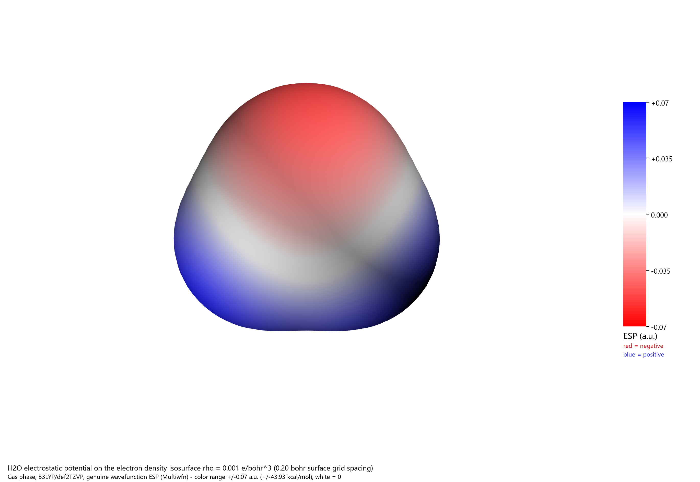

# Ask WorkBuddy to calculate water and draw its ESP

[English](README.md) · [简体中文](README.zh-CN.md)

This example started in the main AI assistant: it passed a calculation brief and a shared project folder to WorkBuddy-Link. **WorkBuddy used GLM-5.3-Flash, its WSL Gaussian skill, and its Multiwfn skill** to calculate water and produce the real data behind this image. VMD/Tachyon rendered the surface; the main assistant checked the results and corrected presentation issues before publishing.



Red marks negative ESP around oxygen; blue marks positive ESP toward the hydrogens. This is an actual wavefunction-based surface, not an illustration or a point-charge approximation. The symmetric color range is −0.07 to +0.07 a.u., with white at zero.

## Try it with your assistant

WorkBuddy must already be signed in, with working Gaussian/WSL and Multiwfn skills. Rendering also needs VMD/Tachyon. These applications and skills are not bundled here; Gaussian requires your own licensed installation.

Copy this into your AI assistant:

```text
Use WorkBuddy-Link to calculate a gas-phase water molecule using WorkBuddy's
WSL Gaussian and Multiwfn skills. Use GLM-5.3-Flash for this task.

Use B3LYP/def2TZVP for optimization and harmonic frequencies, then map the
wavefunction ESP onto the rho=0.001 e/bohr^3 density surface. Save the input,
Gaussian output, fchk, optimized xyz, Multiwfn menu input and output, both
cube grids, a labelled ESP PNG, and a short results summary in our project
folder. Check convergence and imaginary frequencies, preserve existing files,
and record actual WorkBuddy token usage. Follow the example here:
https://github.com/P-PPPP/WorkBuddy-Link/tree/main/examples/water-dft-esp
```

The assistant should discover your skill names, select them before starting a worker, select the requested model, then send the brief and project path together. It should inspect specific permission requests and wait for results. You keep working in your original chat.

## What was actually calculated

| Item | Verified result |
|---|---|
| System | Gas-phase H₂O; charge 0, singlet |
| Method | B3LYP/def2TZVP; tight optimization and SCF; UltraFine integration grid |
| Final SCF energy | −76.4629956141 Hartree |
| O–H bond lengths / H–O–H angle | 0.962706 Å / 105.2434° |
| Dipole | 2.0636 D |
| Harmonic frequencies | 1617.0143, 3785.8927, 3891.0965 cm⁻¹; no imaginary modes |
| Surface definition | ρ = 0.001 e/bohr³; 0.20 bohr surface grid spacing |
| Surface ESP minimum / maximum | −0.05806658 / +0.06795273 a.u. |
| Same extrema in kcal/mol | −36.437363 / +42.641020 |
| Surface area | 45.65324 Ų |
| Final image | 2740 × 1890 px |

Gaussian 16 Rev. A.03 reported normal termination of both the optimization and frequency steps. The formatted checkpoint independently matches the final energy. Multiwfn 2026.6.2 exported **full** density and ESP grids, each 50 × 54 × 50; this run did not use the restricted `-ESPrhoiso` mode. VMD 1.9.3 and its Tachyon renderer produced the image.

The Gaussian output reports 4.5 s and 2.2 s elapsed for its two steps. These are computation timings, **not the total agent workflow time**.

## Inspect or reproduce it

The evidence is included: [results JSON](summary.json), [Chinese summary](summary.zh-CN.md), [input](water.gjf), [optimized geometry](water.xyz), [formatted checkpoint](water.fchk), [Gaussian output](gaussian-output.txt), [Multiwfn input](multiwfn-input.txt), [Multiwfn output](multiwfn-output.txt), [surface extrema](surface-extrema.txt), and [compressed cube grids](water-grids.zip). Local installation paths, host name, and operating-system username were replaced in the published text output; numerical and convergence data were preserved.

To regenerate ESP analysis and the image from the included wavefunction, open PowerShell in this folder:

```powershell
.\Reproduce-Esp.ps1 -OutputDirectory C:\work\water-esp-new
```

Use a **new** output directory. The script accepts `-MultiwfnDirectory` and `-VmdDirectory` if your installations differ. It runs Multiwfn with four threads, then VMD/Tachyon and the Pillow compositor through `uv run --with pillow`. To render the saved grids without rerunning Multiwfn, add `-FromSavedGrids`.

This public wrapper was tested both ways. The full wavefunction-to-image check reproduced the surface-extrema file byte for byte. Rendering can differ slightly between runs; it is not required to be byte-identical.

To repeat the Gaussian calculation itself, run the supplied script **inside WSL** with your Gaussian parent directory and a fresh Linux run directory:

```bash
bash run-gaussian.sh water.gjf "$HOME/water-demo-new" "$HOME"
```

The parent directory must contain `g16/`. The script uses local scratch and refuses Windows mounts or an existing run directory. The input requests four threads and 2 GB RAM. This path-parameterized Gaussian wrapper was syntax-checked; the original calculation was executed by WorkBuddy with the equivalent recorded settings.

Independent checks are in [verification-calculation.json](verification-calculation.json) and [verification-grids.json](verification-grids.json). You can rerun them:

```powershell
.\Verify-WaterCalculation.ps1 -CalculationDirectory .
Expand-Archive .\water-grids.zip C:\work\water-grid-check-new
node .\verify-water-grids.mjs C:\work\water-grid-check-new
```

## Token usage and real limitations

[workbuddy-usage.json](workbuddy-usage.json) records actual per-call input/output/cache counters reported by WorkBuddy, including the initial turn and its continuation. Repeated context is counted for each model call; cache counters are a breakdown and are not added to the total. These records are not a billing invoice, and unreported or failed requests may be absent. Context occupancy is not token consumption.

| Reported usage | Tokens |
|---|---:|
| Input | 1,644,455 |
| Output | 19,717 |
| **Total, 35 model calls** | **1,664,172** |
| Cached reads, included in input | 1,461,760 |

The initial native turn reached the bridge's default 30-minute wait limit before the final composition command was approved. Its state remains `unknown` with `ACP_TIMEOUT`; it was not relabelled completed. A fresh GLM-5.3-Flash worker continued from the existing files without rerunning DFT. It completed final rendering, then ended `cancelled` after an additional read-only log permission was rejected. The public summaries were completed and checked afterward. The continuation used no injected calculation skills and had a two-hour prompt-wait limit.

Main-assistant review corrected the VMD default-representation index, the molecular-plane view, colorbar tick placement and legend clipping. The published scripts contain those corrections. Seven pre-existing Multiwfn/VMD files were hash-checked and left unchanged. Raw conversations, account data, and native session IDs stay local.

This small gas-phase demonstration uses unscaled harmonic frequencies and a finite surface grid. It is not an experimental measurement or a general accuracy benchmark. The slight difference between the two hydrogen-side maxima is numerical surface discretization.

## Software references

If you use Multiwfn for research, follow its citation instructions, including [Lu & Chen, 2012](https://doi.org/10.1002/jcc.22885), [Lu, 2024](https://doi.org/10.1063/5.0216272), and the molecular-surface method cited in the included Multiwfn output. This repository distributes calculation artifacts and scripts, not Gaussian, Multiwfn, VMD, or model access.
