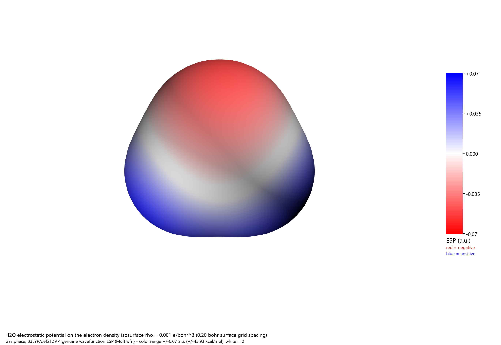

# 让 WorkBuddy 算一个水分子，再画出它的 ESP

[English](README.md) · [简体中文](README.zh-CN.md)

这个示例从主 AI 助手发起：把计算要求和项目文件夹交给 WorkBuddy-Link，**由 WorkBuddy 使用 GLM-5.3-Flash，调用 WSL Gaussian 和 Multiwfn 技能**完成实际计算，再用 VMD/Tachyon 渲染。主助手核验数据，并修正出图问题后发布。



氧一侧的负电势为红色，氢一侧的正电势为蓝色。这是实际波函数计算得到的表面，不是示意图或点电荷近似。色标范围对称地设为 −0.07 至 +0.07 a.u.，白色表示零。

## 发给你的 AI 助手

使用前，WorkBuddy 应已登录，WSL Gaussian 和 Multiwfn 技能应能正常工作；出图还需要 VMD/Tachyon。这些软件和技能不包含在本仓库内，Gaussian 需要你自己的合法安装。

复制下面这段话：

```text
通过 WorkBuddy-Link，让 WorkBuddy 使用 WSL Gaussian 和 Multiwfn 技能，
计算一个气相水分子。这次使用 GLM-5.3-Flash。

采用 B3LYP/def2TZVP 优化结构并计算谐振频率，再把实际波函数的 ESP
映射到 rho=0.001 e/bohr^3 的电子密度等值面。将输入、Gaussian 输出、
fchk、优化后的 xyz、Multiwfn 菜单输入及输出、两个 cube 网格、带色标
的 ESP PNG 和结果说明保存到我们的项目文件夹。检查收敛与虚频，保留
已有文件，并记录 WorkBuddy 实际 token 用量。参考这个实测示例：
https://github.com/P-PPPP/WorkBuddy-Link/tree/main/examples/water-dft-esp
```

主助手应先查询你电脑上的技能名称，选好技能再创建工作会话，选择指定模型，然后一起传递任务与项目路径。执行中检查具体权限请求、等待结果；你继续留在原来的聊天里。

## 实际算出了什么

| 项目 | 已核验结果 |
|---|---|
| 体系 | 气相 H₂O；电荷 0，单重态 |
| 方法 | B3LYP/def2TZVP；紧优化及 SCF 收敛；UltraFine 积分网格 |
| 最终 SCF 能量 | −76.4629956141 Hartree |
| O–H 键长 / H–O–H 键角 | 0.962706 Å / 105.2434° |
| 偶极矩 | 2.0636 D |
| 谐振频率 | 1617.0143、3785.8927、3891.0965 cm⁻¹；无虚频 |
| 表面定义 | ρ = 0.001 e/bohr³；表面网格间距 0.20 bohr |
| 表面 ESP 最小值 / 最大值 | −0.05806658 / +0.06795273 a.u. |
| 同一极值，单位 kcal/mol | −36.437363 / +42.641020 |
| 表面积 | 45.65324 Ų |
| 最终图片 | 2740 × 1890 像素 |

Gaussian 16 Rev. A.03 的优化及频率步骤均正常结束，fchk 中的总能量也与输出一致。Multiwfn 2026.6.2 导出了两个 50 × 54 × 50 的**完整**密度/ESP 网格，本次没有使用 `-ESPrhoiso` 的局部网格模式。图片由 VMD 1.9.3 和附带的 Tachyon 渲染器生成。

Gaussian 两个步骤报告的耗时分别为 4.5 秒和 2.2 秒，这是数值计算耗时，**不是整个智能体流程的总耗时**。

## 查看或自己复现

仓库提供[结果 JSON](summary.json)、[中文摘要](summary.zh-CN.md)、[输入文件](water.gjf)、[优化结构](water.xyz)、[波函数](water.fchk)、[Gaussian 输出](gaussian-output.txt)、[Multiwfn 输入](multiwfn-input.txt)、[Multiwfn 输出](multiwfn-output.txt)、[表面极值](surface-extrema.txt)和[压缩网格](water-grids.zip)。公开文本中的本机安装路径、主机名及系统用户名已替换，数值与收敛信息保留。

在本目录打开 PowerShell，使用附带的波函数重新分析并出图：

```powershell
.\Reproduce-Esp.ps1 -OutputDirectory C:\work\water-esp-new
```

请使用**尚不存在**的输出目录。安装位置不同时可传入 `-MultiwfnDirectory` 和 `-VmdDirectory`。脚本以 4 线程运行 Multiwfn，再调用 VMD/Tachyon，并通过 `uv run --with pillow` 合成 PNG。只想用已保存的网格重新渲染，可加上 `-FromSavedGrids`。

上述两种方式均已实测。完整的“波函数 → 分析 → 出图”复现得到的表面极值文件与原文件逐字节一致。不同次渲染可能有少量像素差异，不要求图片逐字节相同。

如果要重新计算 Gaussian，请在 **WSL 内**运行下方脚本，使用自己的 Gaussian 父目录和全新的 Linux 运行目录：

```bash
bash run-gaussian.sh water.gjf "$HOME/water-demo-new" "$HOME"
```

Gaussian 父目录应包含 `g16/`。脚本使用本地 scratch，拒绝 Windows 挂载路径和已存在的运行目录。输入指定 4 核、2 GB。这个参数化脚本已通过语法检查；原始计算由 WorkBuddy 按记录中的等价设置实际执行。

独立检查结果见 [verification-calculation.json](verification-calculation.json) 和 [verification-grids.json](verification-grids.json)，也可自行运行：

```powershell
.\Verify-WaterCalculation.ps1 -CalculationDirectory .
Expand-Archive .\water-grids.zip C:\work\water-grid-check-new
node .\verify-water-grids.mjs C:\work\water-grid-check-new
```

## Token 与真实边界

[workbuddy-usage.json](workbuddy-usage.json) 保存 WorkBuddy 原生逐次调用报告的输入、输出及缓存 token，包含首次轮次和接续会话。重复传入的上下文会按每次实际请求计入；缓存是细分项，不再叠加到总量中。这不是账单，未报告或失败请求可能未被覆盖。上下文占用不等于累计消耗。

| 原生用量记录 | Token |
|---|---:|
| 输入 | 1,644,455 |
| 输出 | 19,717 |
| **总计，35 次模型调用** | **1,664,172** |
| 缓存读取，已包含在输入中 | 1,461,760 |

第一次原生轮次在最后一次合成命令获准前，触发桥接器默认的 30 分钟等待上限。该轮次保留 `unknown` / `ACP_TIMEOUT`，没有改写成完成。新的 GLM-5.3-Flash 工作会话使用已有文件接续收尾，没有重算 DFT。它完成了最终渲染，随后一次额外的只读日志权限被拒绝，原生任务结束为 `cancelled`。公开摘要随后补齐并核验。接续会话未再注入计算技能，等待上限为两小时。

主助手检查并修正了 VMD 默认图层索引、分子平面视角、色标刻度位置及图例裁切；发布的脚本包含这些修正。7 个已有的 Multiwfn/VMD 文件经过哈希检查，保持不变。原始对话、账户信息和原生会话标识只留在本机。

这是使用未缩放谐振频率和有限表面网格的小分子气相演示，不是实验测量，也不是通用精度基准。两侧氢的表面最大值略有差别，来自表面离散化。

## 软件引用

研究中使用 Multiwfn 时，请遵循其引用说明，包括 [Lu 与 Chen，2012](https://doi.org/10.1002/jcc.22885)、[Lu，2024](https://doi.org/10.1063/5.0216272)，以及附带输出中列出的分子表面算法论文。本仓库提供计算数据及脚本，不分发 Gaussian、Multiwfn、VMD，也不提供模型使用权益。
